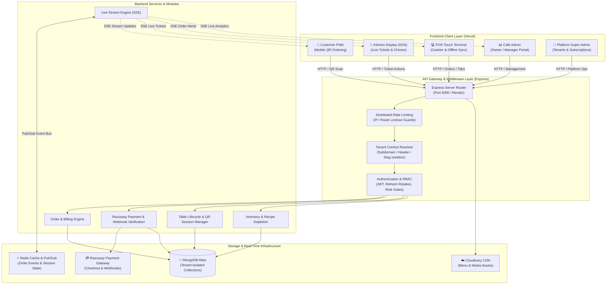
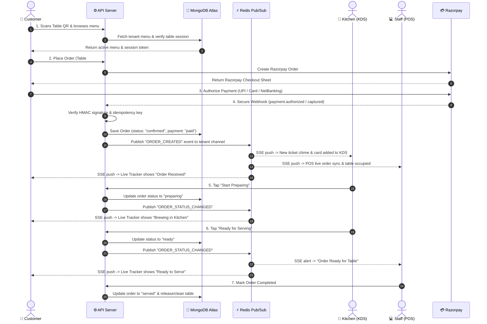
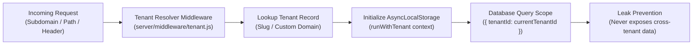
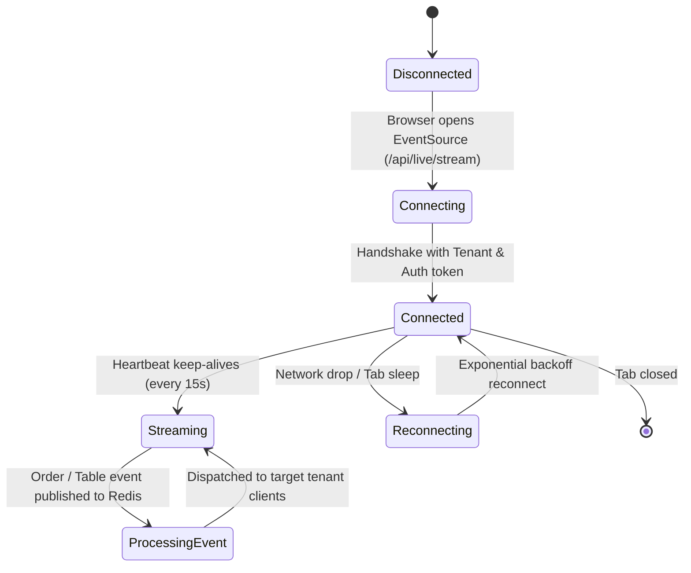
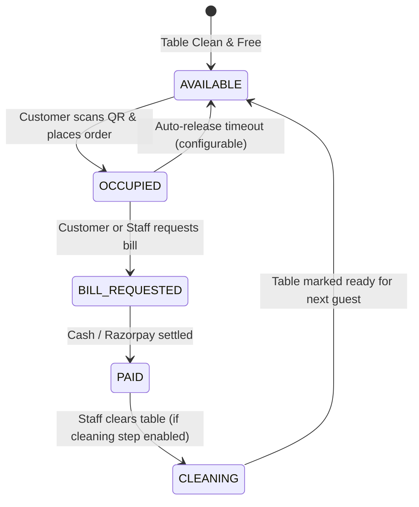

# ☕ Brewhaus Café — Multi-Tenant SaaS Platform

A full-stack, multi-café SaaS web application with MongoDB Atlas, real-time Server-Sent Events (SSE), QR-based digital ordering, Razorpay payment processing, and 5 independently deployable frontend applications managed in an npm workspaces monorepo.

---

## 🏛 System Architecture Diagram



---

## 🔄 How the System Works

### 1. End-to-End Order & Realtime Fulfillment Lifecycle



---

### 2. Multi-Tenant Architecture & Data Isolation

Brewhaus Café is designed from the ground up as a secure **Multi-Tenant SaaS**:



1. **Automatic Tenant Resolution**: The API identifies the tenant by matching the `tenant` query parameter, custom domain, or `X-Tenant-ID` header.
2. **Context Isolation via AsyncLocalStorage**: All downstream route handlers and database queries run inside an isolated `AsyncLocalStorage` context (`tenantContext.js`), ensuring data for Café A cannot be queried or updated by Café B.
3. **Encrypted Payment Gateways**: Each tenant can plug in their own Razorpay Key ID and Key Secret. Credentials are encrypted at rest with AES-256-GCM.
4. **Custom Theming & White-Labeling**: Colors, logos, address, and currency formatting are stored in the `Tenant` document and automatically applied to the customer storefront.

---

### 3. Real-Time Event Architecture (SSE + Redis)

Instead of relying on heavy WebSocket handshakes or aggressive browser polling, Brewhaus uses **Server-Sent Events (SSE)** coupled with **Redis Pub/Sub**:



- **Resilient Connection**: Handled by `@cafe/shared/liveStream.js`. Automatically detects browser tab hibernation and network changes, gracefully reconnecting without duplicate data loss.
- **Horizontal Scalability**: If the server is scaled to multiple container instances, the central **Redis Pub/Sub** broker ensures that an order created on Server Instance 1 is instantly pushed to the KDS connected to Server Instance 2.

---

### 4. Table & Dining Session Lifecycle



- **Dynamic QR Codes**: Each table is provisioned with a secure HMAC-signed QR code.
- **Dine-In Session Isolation**: Orders placed during the same dining session are grouped together onto a single tab until the session is settled and closed.
- **Auto-Release & Cleaning Guards**: Prevents phantom locks by releasing dormant tables after a configurable duration.

---

## 🏗 Monorepo Applications Structure

```
cafe-app/
├── apps/
│   ├── customer/       # Public Mobile-First QR Ordering & Live Tracking (Port 5173)
│   ├── pos/            # Cashier Touch Terminal with Offline Queue (Port 5174)
│   ├── kds/            # Kitchen Display System with Chimes & Timers (Port 5175)
│   ├── admin/          # Café Owner & Manager Back-Office & Reports (Port 5176)
│   └── super-admin/    # Multi-Tenant Platform Operator Portal (Port 5177)
├── packages/
│   └── shared/         # @cafe/shared: Types, formatters, tokens, SSE, UI components
└── server/             # Express.js + MongoDB Atlas Backend API (Port 5000)
```

---

## 📱 Applications Matrix

| App | Target Users / Role Gate | Dev Command | Port | Vercel Root Directory | Production Domain | Key Environment Variables |
|---|---|---|---|---|---|---|
| **apps/customer** | Public (no login)<br>Mobile-first QR table ordering | `npm run dev:customer` | `5173` | `apps/customer` | `https://cafestore-customer.vercel.app` | `VITE_API_URL`<br>`VITE_RAZORPAY_KEY_ID`<br>`VITE_ADMIN_URL` |
| **apps/pos** | Staff (`cashier`, `manager`, `owner`)<br>Touch register, offline queue, tabs | `npm run dev:pos` | `5174` | `apps/pos` | `https://cafestore-pos.vercel.app` | `VITE_API_URL`<br>`VITE_ADMIN_URL`<br>`VITE_KDS_URL` |
| **apps/kds** | Kitchen (`kitchen`, `manager`, `owner`)<br>Live ticket board, timers, chimes | `npm run dev:kds` | `5175` | `apps/kds` | `https://cafestore-kds.vercel.app` | `VITE_API_URL`<br>`VITE_ADMIN_URL`<br>`VITE_POS_URL` |
| **apps/admin** | Management (`owner`, `manager`)<br>Inventory, CRM, GST reports, Settings | `npm run dev:admin` | `5176` | `apps/admin` | `https://cafestore-admin.vercel.app` | `VITE_API_URL`<br>`VITE_CUSTOMER_URL`<br>`VITE_POS_URL`<br>`VITE_KDS_URL` |
| **apps/super-admin** | Platform Ops (`superadmin`)<br>Tenant management, billing plans, audit | `npm run dev:super-admin` | `5177` | `apps/super-admin` | `https://cafestore-superadmin.vercel.app` | `VITE_API_URL`<br>`VITE_ADMIN_URL` |
| **server** | Backend API & SSE Engine | `npm run dev:server` | `5000` | Render | `https://cafestore-nmue.onrender.com` | `MONGO_URI`<br>`JWT_SECRET`<br>`REDIS_URL`<br>`CUSTOMER_APP_URL` |

---

## 📦 Shared Core: `@cafe/shared`

The single source of truth for code shared between the frontend applications:
- **`money.js`**: `formatINR`, `formatGSTRate`, currency rounding helpers.
- **`roles.js`**: Role definitions (`ROLES`), app access control check (`canAccessApp`), and role display labels.
- **`accessToken.js`**: Session storage token helpers with legacy fallback.
- **`liveStream.js`**: Resilient SSE connection factory with automatic backoff reconnection and tab visibility handling.
- **`phoneNormalizer.js`**: Indian 10-digit phone normalization and validation.
- **`download.js`**: Blob download helper for reports and receipts.
- **`UnauthorizedScreen.jsx`**: Reusable unauthorized error view for wrong-role attempts.
- **`ImageWithFallback.jsx`**: Resilient image loader with placeholder fallback.

---

## 🚀 Quick Start

### 1. Prerequisites
- Node.js 20+ or 22+
- MongoDB Atlas or local MongoDB 7 instance
- Redis instance (optional locally; uses `ioredis-mock` in testing)
- Razorpay account (test mode credentials work)

### 2. Install Dependencies
```bash
git clone https://github.com/InfinigrowSoftech3/CafeStore.git
cd CafeStore
npm install
npm install --prefix server
```

### 3. Environment Setup
```bash
# Server
cp server/.env.example server/.env

# Apps
cp apps/customer/.env.example apps/customer/.env
cp apps/pos/.env.example apps/pos/.env
cp apps/kds/.env.example apps/kds/.env
cp apps/admin/.env.example apps/admin/.env
cp apps/super-admin/.env.example apps/super-admin/.env
```

### 4. Seed Database
```bash
npm run seed
```

### 5. Run Development Servers
To start all services concurrently (Server, Customer, POS, KDS, Admin):
```bash
npm run dev
```

Or run any service individually:
- Customer: `npm run dev:customer` (http://localhost:5173)
- POS Terminal: `npm run dev:pos` (http://localhost:5174)
- KDS Board: `npm run dev:kds` (http://localhost:5175)
- Admin Panel: `npm run dev:admin` (http://localhost:5176)
- Super Admin: `npm run dev:super-admin` (http://localhost:5177)
- API Server: `npm run dev:server` (http://localhost:5000)

### 6. Production Builds & Tests
```bash
# Run ESLint across all workspaces
npm run lint

# Run backend test suite
npm test

# Build all 5 frontend applications and sync dist
npm run build
```

---

## 🔒 Security & Compliance

- **Tenant Isolation**: Compound unique indexes and `AsyncLocalStorage` enforce strict tenant separation.
- **Credentials Encryption**: Tenant payment secrets are AES-256-GCM encrypted; secrets are never logged or exposed in JSON payloads.
- **Anti-Tamper QR Sessions**: Table QR tokens are cryptographically signed using HMAC SHA-256.
- **Rate Limiting**: Multi-tiered rate limiting per IP and per endpoint for sensitive operations (login, payments).
- **Audit Trails**: Super-admin and sensitive actions are recorded in an append-only `AuditEvent` log.

---

## 📄 License & Credits
Built with ☕ by [Infinigrow Softech](https://github.com/InfinigrowSoftech3).
